# App mobile do cidadão

App Expo (SDK 58) do Fácil Município. Protótipo acadêmico para a Global Solution CitizenTech 2026. O escopo, a arquitetura, as decisões e as verificações estão em [docs/features/mobile-app.md](../../docs/features/mobile-app.md).

Respostas marcadas como insuficientes exibem a mensagem recebida da API, inclusive quando a orientação é bloqueada por privacidade. Se a mensagem vier vazia, o app mostra uma orientação genérica.

## Ficha da CitizenTech

| Item | Descrição |
|---|---|
| Nome | Fácil Município — Wiki Cidade |
| Cidade e bairro | Poá (SP) |
| Cidadão beneficiado | Moradores que precisam encontrar informações sobre serviços urbanos |
| Problema, em uma frase | É difícil saber qual serviço procurar e onde encontrar orientações confiáveis |
| Como funciona | O cidadão escolhe o município, faz uma pergunta em linguagem simples e recebe uma orientação baseada só no conhecimento revisado e publicado, com a fonte consultada |
| O que cada parte faz | **App Expo (esta pasta):** perguntas, fontes e histórico salvo no celular. **API em C# (`apps/api` na `main`):** cadastro, revisão, publicação e consulta, com PostgreSQL e Neo4j. Demais partes: ver o [README da raiz na main](https://github.com/Luansramos/F-cil-Munic-pio-wiki-cidade/blob/main/README.md) |
| Link da entrega Mobile | [apps/mobile na branch feature/mobile](https://github.com/Luansramos/F-cil-Munic-pio-wiki-cidade/tree/feature/mobile/apps/mobile) |
| Indicador de impacto (proposta) | Respostas acompanhadas de fonte e acerto das orientações nos testes do grupo. Ainda não são resultados de impacto |
| ODS conectados | ODS 11 (facilitar o acesso a informações sobre serviços urbanos) e ODS 16 (acesso à informação pública e transparência) |
| Integrantes | Fernanda Rocha Menon (RM 554673), Luiza Macena Dantas (RM 556237), Luan Ramos Garcia de Souza (RM 558537), Matheus Ricciotti (RM 556930), Matheus Bortolotto (RM 555189) |

A Prefeitura de Poá é uma referência para o piloto, não uma parceira do projeto.

## Atendimento aos critérios de Mobile

| Critério | Implementação na entrega | Onde conferir |
|---|---|---|
| Telas e navegação | Quatro telas: Início, Conversa, Histórico e Preferências. Abas para as áreas principais, abertura e retomada de conversas e painel de fontes. | Prints, vídeo, `app/` e `screens/` |
| Consumo de dados | Cliente de API com seleção entre mock local e API HTTP em C#. Consulta municípios, serviços e respostas; trata carregamento, falhas e ausência de informação suficiente. | Prints da integração e `services/api/` |
| Banco de dados | SQLite local com conversas, trocas e preferências; permite reabrir o histórico e excluir conversas. | Tela Histórico e `services/banco/` |
| Acessibilidade | Ampliação persistida do texto, rótulos de acessibilidade, anúncios de estado e mensagens de orientação e erro. | Preferências, prints de texto maior e componentes das telas |
| Aderência ao problema | O morador descreve sua necessidade em linguagem simples e recebe orientação por município, com fontes e indicação de quando não há conhecimento suficiente. | Ficha CitizenTech, Conversa e painel de fontes |
| Documentação | Ficha, integrantes, requisitos, configuração, instruções de execução, prints e vídeo de até três minutos. | Este README |

Os recursos de acessibilidade estão implementados; não há evidência de avaliação com VoiceOver ou TalkBack. O impacto social descrito na ficha é uma hipótese a avaliar com usuários.

## Telas e jornada

1. **Início:** escolher o município, consultar os serviços disponíveis e iniciar uma conversa.
2. **Conversa:** enviar a pergunta, ler a orientação e consultar suas fontes. Sem cobertura suficiente, o app apresenta uma orientação para procurar o canal oficial.
3. **Histórico:** consultar e retomar conversas salvas, filtrar por município e excluir registros com confirmação.
4. **Preferências:** ajustar o tamanho do texto, consultar informações de privacidade e apagar o histórico.

O mock permite demonstrar a jornada sem depender do backend. Novas respostas da API exigem conexão; o histórico e as preferências ficam armazenados localmente. O aplicativo orienta o cidadão, sem protocolar solicitações junto à prefeitura.

## Prints das telas

As capturas foram feitas em 17/11/2026 no **navegador** (Chrome, tela de 393 × 852, escala 2x), com o app compilado para a web. **Não são capturas de um celular físico.** Todos os dados são de exemplo ou públicos; nenhuma pergunta contém dado pessoal.

### Modo demonstrativo (`EXPO_PUBLIC_USAR_MOCK=true`)

Respostas de exemplo, marcadas com "(Exemplo)" e com o selo "Demonstração". Os serviços e as orientações associados a "São Paulo" são exemplos fictícios do protótipo, sem vínculo com o atendimento oficial da cidade.

| 1. Início | 2. Resposta com fonte | 3. Fontes da resposta | 4. Sem informação suficiente |
|---|---|---|---|
| 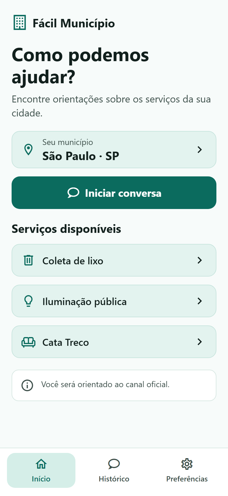 | 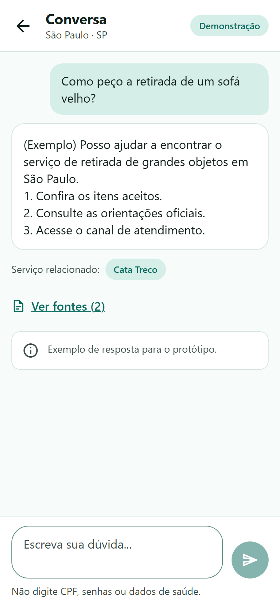 | 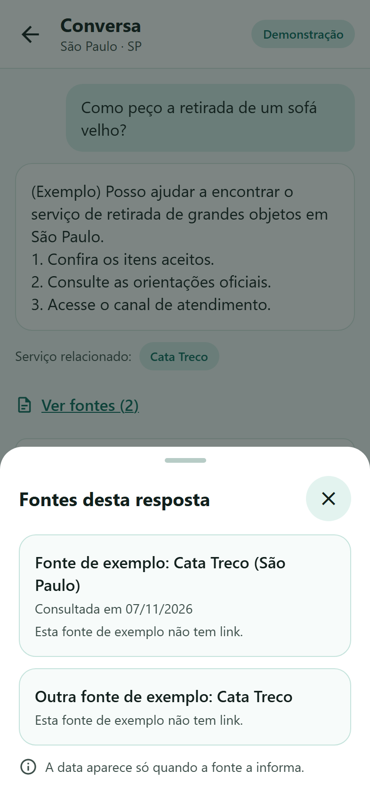 | 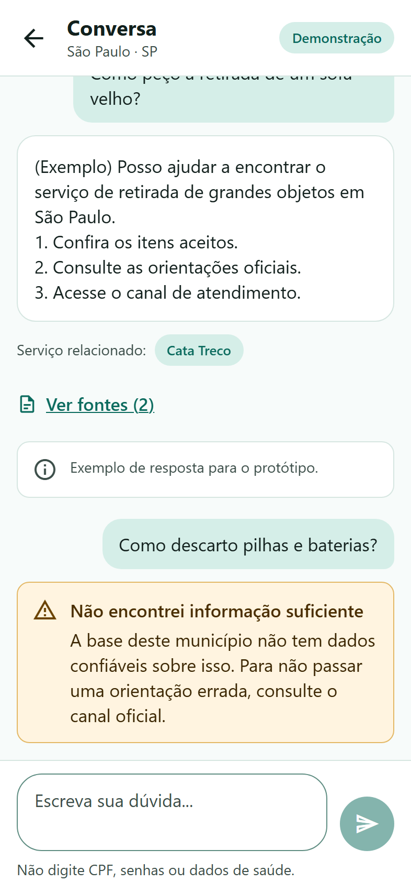 |

| 5. Histórico (salvo no celular) | 6. Preferências | 7. Texto maior | 8. Início com texto maior |
|---|---|---|---|
| 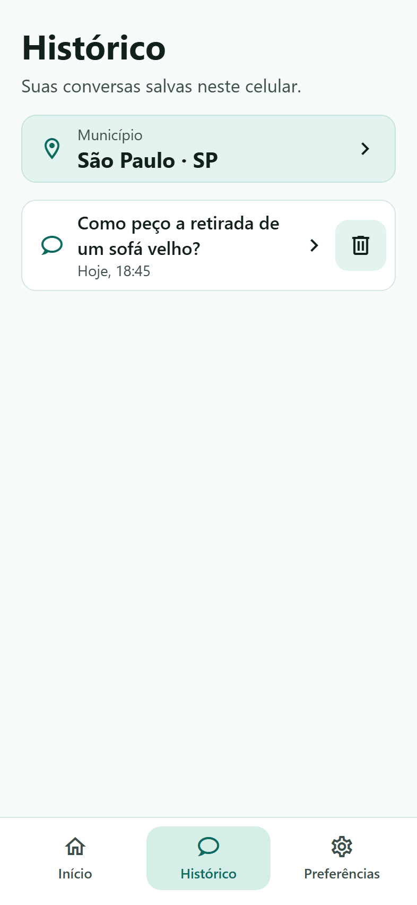 | 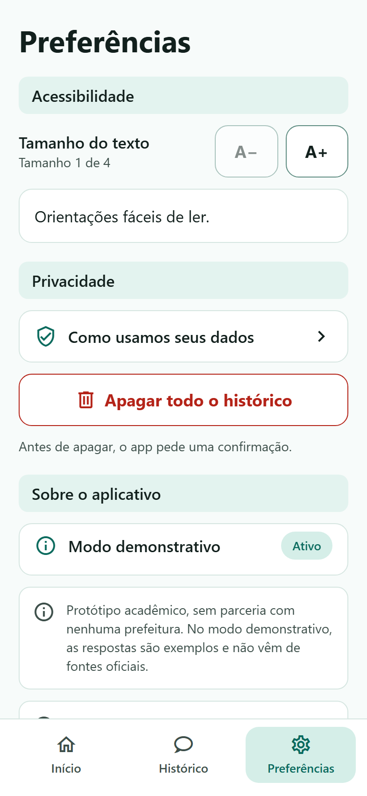 | 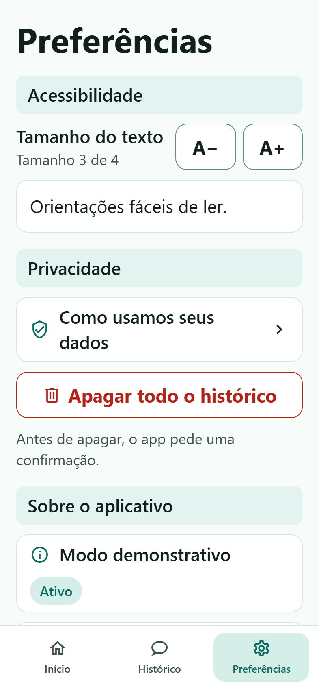 | 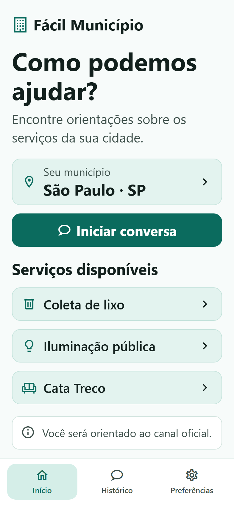 |

### Com a API em C# (`EXPO_PUBLIC_USAR_MOCK=false`)

O app lê municípios, serviços e respostas da API real em C# rodando no mesmo computador, em modo demonstração do conhecimento (`Llm__Mode=demo`: devolve o texto já revisado e publicado, **sem LLM**). O conteúdo de Poá vem do roteiro `scripts/demo_fluxo_http.py` da API, a partir de uma página pública da Prefeitura de Poá.

| 1. Município sem serviços | 2. Escolha do município | 3. Poá com serviço publicado |
|---|---|---|
| 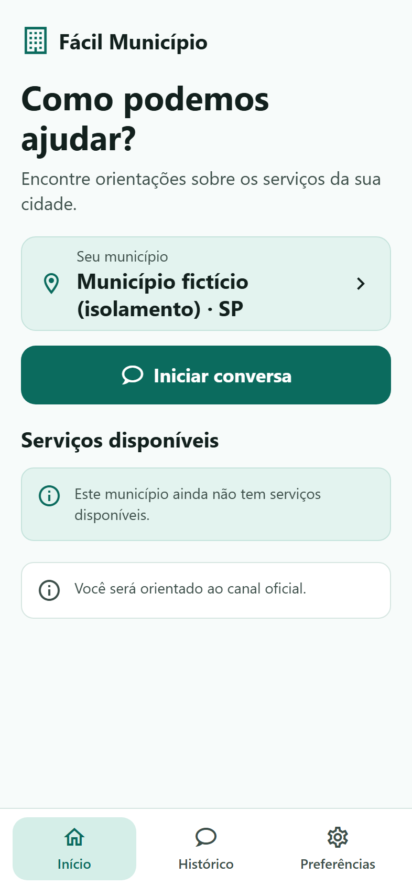 | 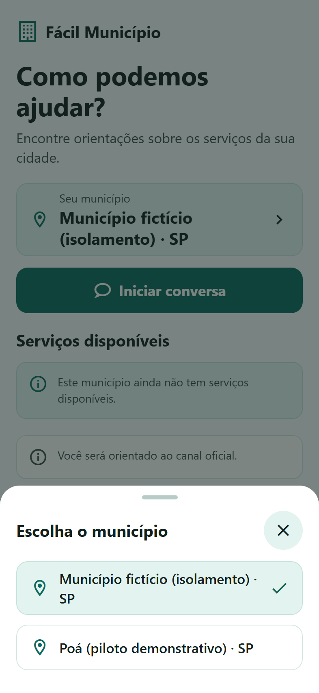 | 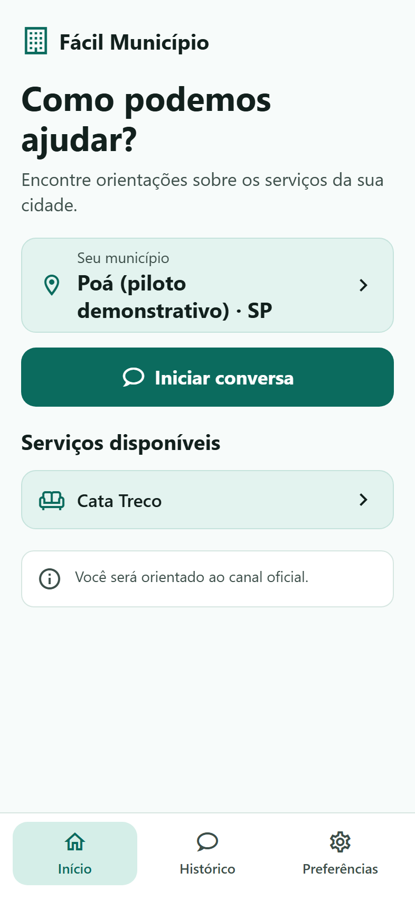 |

| 4. Resposta da API | 5. Fonte oficial | 6. Sem informação suficiente |
|---|---|---|
| 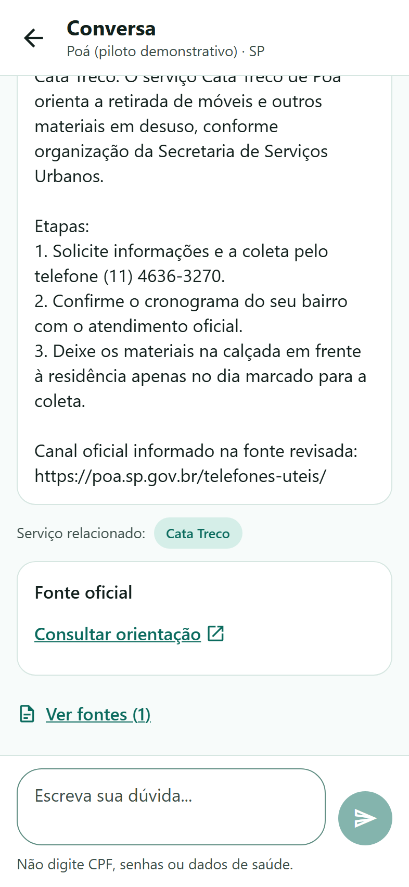 | 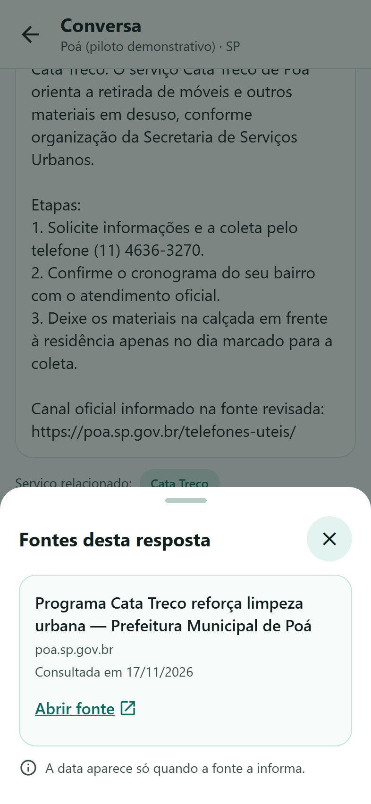 | 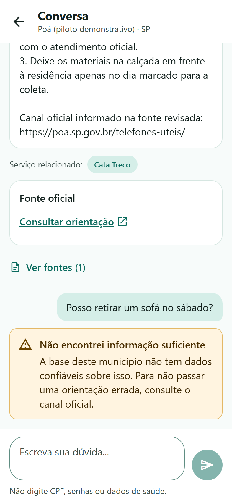 |

**Como foram feitas:** `expo export --platform web` e um servidor estático local que envia os cabeçalhos `Cross-Origin-Embedder-Policy: credentialless` e `Cross-Origin-Opener-Policy: same-origin`. No Chrome automatizado, o servidor de desenvolvimento (`npm run web`) não chegou a abrir o banco local; o build de produção abriu normalmente. Não foi investigada a causa.

## Vídeo de demonstração (até 3 minutos)

**Link: <https://youtu.be/r4uhjS2fZNY>** (2 min 46 s, 2560×1440). O vídeo foi gerado em Remotion, com a gravação real do app web em tela de celular, contra a API em C# em modo demonstração, e a narração da equipe. Não é um celular físico.

## Requisitos

- **Node.js 22.13 ou superior** (faixa completa em `engines`: `^22.13.0 || ^24.3.0 || ^26.0.0 || >=27.0.0`). Vem do `expo@58` e do `react-native@0.88`; o `node:sqlite` usado nos testes também exige 22.13 ou superior sem flag. Verificado apenas com a 22.22.0.
- npm 10 ou superior (verificado com 10.9.4).

## Comandos verificados

Dentro de `apps/mobile`:

```bash
npm install
npm run typecheck
npm run lint
npm test
npx expo-doctor
npx expo export --platform android
npx expo export --platform ios
npx expo export --platform web
```

`expo export` só confirma que o bundle compila, não que o app roda no aparelho.

## Rodar na web (desenvolvimento)

```bash
npm run web
```

O `expo run` não serve para isso. O SQLite na web usa WebAssembly e o armazenamento do navegador (OPFS); o `metro.config.js` empacota o `.wasm` e envia os cabeçalhos `Cross-Origin-Embedder-Policy: credentialless` e `Cross-Origin-Opener-Policy: same-origin` nas respostas do Metro. Se abrir o app em duas abas ao mesmo tempo, a segunda não consegue abrir o banco (acesso exclusivo ao arquivo) e mostra "Não foi possível abrir seus dados".

## Rodar a versão web exportada

Para reproduzir o caminho usado nas capturas, execute em `apps/mobile`:

```bash
npx expo export --platform web
```

Com Python 3 instalado, sirva a pasta exportada com os cabeçalhos exigidos pelo SQLite web:

```bash
python -c "import os
from http.server import SimpleHTTPRequestHandler, ThreadingHTTPServer
os.chdir('dist')
class Handler(SimpleHTTPRequestHandler):
    def end_headers(self):
        self.send_header('Cross-Origin-Embedder-Policy', 'credentialless')
        self.send_header('Cross-Origin-Opener-Policy', 'same-origin')
        super().end_headers()
ThreadingHTTPServer(('127.0.0.1', 8081), Handler).serve_forever()
"
```

Abra `http://localhost:8081` no Chrome, mantendo apenas uma aba do app aberta. No Windows, se necessário, use `py -3` no lugar de `python`. Encerre qualquer servidor que já esteja usando a porta 8081. Alterações nas variáveis `EXPO_PUBLIC_*` exigem uma nova exportação.

## Rodar no Expo Go em um celular

1. No celular, instale o **Expo Go** pela Google Play (Android) ou pela App Store (iPhone) com uma versão compatível com o SDK 58 utilizado pelo projeto.
2. Conecte o celular e o computador **na mesma rede Wi-Fi**.
3. No computador, em `apps/mobile`:
   ```bash
   npm install
   npm start
   ```
4. No terminal aparece um QR code. No Android, abra o Expo Go e toque em **Scan QR code**. A câmera do celular sozinha pode não abrir o Expo Go. No iPhone, leia o QR code com a câmera e abra o link no Expo Go.
5. Se o celular não achar o computador, libere o Node.js no firewall do Windows para redes privadas (porta 8081) ou tente `npx expo start --tunnel` (pode pedir para instalar um pacote de túnel).
6. Para conferir o banco local: escolha um município no Início, feche o Expo Go por completo (deslizando-o para fora dos apps recentes) e reabra o app. O município escolhido deve continuar o mesmo.

`npm run android` (`expo run:android`) gera o app nativo e exige o Android Studio; não é necessário para o Expo Go.

O `app.json` está preparado para Android: `android.package` definido e `android.allowBackup: false` (ver "Dados no aparelho").

## Rodar o app com a API em C# e Azure OpenAI

O app usa dados locais de exemplo por padrão. Para integrar com a API, configure o app com `EXPO_PUBLIC_USAR_MOCK=false`. A API pode responder em modo demonstrativo, sem LLM, ou em modo Azure OpenAI. O app nunca precisa receber a chave do Azure.

### Pré-requisitos

- Node.js 22.13 ou superior e npm 10 ou superior.
- .NET SDK 10.
- Docker Desktop com Docker Compose.
- Python 3 para executar o roteiro de dados de teste.

### 1. Preparar os bancos e a API

Na raiz do repositório, copie `.env.example` para `.env` (se ainda não existir) e substitua as senhas de exemplo. No mesmo arquivo, configure também:

```dotenv
ConnectionStrings__Postgres=Host=localhost;Database=facil_municipio;Username=facil;Password=<MESMA_SENHA_DE_POSTGRES_PASSWORD>
Neo4j__Uri=bolt://localhost:7687
Neo4j__User=neo4j
Neo4j__Password=<MESMA_SENHA_DE_NEO4J_PASSWORD>
Jwt__Key=<SEGREDO_ALEATORIO_COM_PELO_MENOS_32_BYTES>
Bootstrap__Email=operador@example.test
Bootstrap__Password=<SENHA_LOCAL_COM_12_OU_MAIS_CARACTERES>
Llm__Mode=demo
```

O `.env.example` já contém `POSTGRES_PASSWORD` e `NEO4J_PASSWORD`, usados pelo Docker Compose. Use as mesmas senhas na connection string do PostgreSQL e em `Neo4j__Password`. Mantenha esse `.env` somente na máquina local: ele é ignorado pelo Git.

Abra um terminal na raiz e execute:

```bash
docker compose up -d
dotnet restore apps/api/FacilMunicipio.Api.csproj
dotnet run --project apps/api -- --migrate
dotnet run --project apps/api -- --bootstrap
dotnet run --project apps/api -- --urls http://127.0.0.1:5055
```

Esse primeiro modo (`Llm__Mode=demo`) não chama um provedor de IA. Para criar dados locais de Poá e publicar o exemplo do Cata Treco, abra outro terminal na raiz e informe ao roteiro o mesmo usuário operador configurado no `.env`:

```powershell
$env:API_BASE_URL = "http://127.0.0.1:5055"
$env:Bootstrap__Email = "operador@example.test"
$env:Bootstrap__Password = "<A_MESMA_SENHA_DO_ENV>"
python scripts/demo_fluxo_http.py
```

O roteiro cria municípios de teste com identificadores aleatórios e publica uma orientação de demonstração baseada em fonte pública. Ele aprova automaticamente apenas esse conteúdo de teste; não use esse roteiro para publicar conteúdo real.

### 2. Conectar e iniciar o app

Crie ou edite `apps/mobile/.env`:

```dotenv
EXPO_PUBLIC_USAR_MOCK=false
EXPO_PUBLIC_API_URL=http://127.0.0.1:5055/api/v1
```

Em outro terminal:

```bash
cd apps/mobile
npm install
npm run web
```

Abra o endereço mostrado pelo Expo, normalmente `http://localhost:8081`, e escolha Poá na lista. Se o navegador não abrir o SQLite no servidor de desenvolvimento, use o procedimento da seção [Rodar a versão web exportada](#rodar-a-versão-web-exportada), que inclui os cabeçalhos necessários ao banco local. As alterações em `EXPO_PUBLIC_*` exigem reiniciar o Expo ou gerar uma nova exportação.

Para executar no Expo Go, use o IP do computador na rede Wi-Fi no lugar de `127.0.0.1` e inicie a API escutando em todas as interfaces:

```bash
dotnet run --project apps/api -- --urls http://0.0.0.0:5055
```

O celular e o computador devem estar na mesma rede; libere a porta 5055 no firewall. As demais instruções estão em [Rodar no Expo Go em um celular](#rodar-no-expo-go-em-um-celular).

### 3. Habilitar chamadas Azure OpenAI

Depois de preparar e publicar os dados de teste, pare a API com `Ctrl+C`. No `.env` da raiz, troque o modo demonstrativo por uma configuração Azure válida:

```dotenv
LLM__MODE=azure
ENDPOINT_AZURE=https://<RECURSO>.services.ai.azure.com/openai/v1
LLM_KEY_AZURE=<CHAVE_SECRETA_DO_AZURE>
LLM_AZURE_DEPLOYMENT=gpt-5-mini
```

Inicie novamente a API com o comando da etapa 1. Faça uma pergunta sobre o serviço publicado no app. As chamadas reais podem gerar custo no Azure. Também é possível conferir a conexão do SDK, sem bancos ou app, com `dotnet run --project apps/api -- --llm-smoke`.

**Segredos:** `LLM_KEY_AZURE` fica apenas no `.env` da raiz, no ambiente do backend ou no cofre de segredos do provedor de hospedagem. Não coloque a chave em `apps/mobile/.env`, em variáveis `EXPO_PUBLIC_*`, nem em commits.

**Esforço do modelo:** o teste local de ponta a ponta em 18/11/2026 usou `gpt-5-mini` com esforço de raciocínio `minimal` e limite de saída ajustado em uma cópia local da API. Esses ajustes temporários não estão neste PR #7 nem no código da API em `main`; portanto, a configuração Azure acima habilita o provedor, mas não aplica por si só o esforço mínimo daquele teste. A API ainda precisa receber e validar esses ajustes para que o comportamento seja reproduzível a partir do repositório.

### O que foi verificado e o que falta

No commit do PR #7 `2c8aee6`, os testes do app, o typecheck e o lint passaram localmente. O teste web com API, PostgreSQL, Neo4j e Azure também foi executado em ambiente local isolado em 18/11/2026; ele usou os ajustes temporários da API descritos acima. No momento do registro, o GitHub indicava o PR como mergeável, mas não apresentava checks automáticos nem revisões submetidas. Essas verificações do PR não substituem uma execução limpa do backend Azure com os ajustes versionados.

## Dados no aparelho

O histórico e as preferências ficam em um banco SQLite local (`facil-municipio.db`), no aparelho, sem criptografia: a proteção vem do isolamento do aplicativo pelo sistema operacional. O app liga `secure_delete` para que os dados apagados sejam sobrescritos no arquivo, o que não garante que eles sejam irrecuperáveis. No Android, `allowBackup: false` impede o backup automático para o Google Drive. **Isso vale só para o Android**: o comportamento de backup no iOS não foi configurado nem verificado.

## Configuração

Copie `.env.example` para `.env` para alterar a configuração. O `.env` não é versionado.

- `EXPO_PUBLIC_USAR_MOCK`: `true` por padrão. Com `false`, o app usa `EXPO_PUBLIC_API_URL`.
- `EXPO_PUBLIC_API_URL`: URL base da API, sem barra no fim. A API em C# (`apps/api` na `main`) expõe as rotas em `/api/v1`, então o valor é `http://<host>:<porta>/api/v1`. Testado em 17/11/2026 no navegador contra a API local; ver "Rodar contra a API em C#".
- `EXPO_PUBLIC_MOCK_LATENCIA_MS`: atraso simulado do mock, 600 por padrão.

Com `EXPO_PUBLIC_USAR_MOCK=true`, o app usa dados de exemplo locais, sem links e sem rede (veja "Camada de API e dados mockados" em `mobile-app.md`).

Variáveis `EXPO_PUBLIC_*` ficam visíveis no app. Não coloque segredos nelas.

## Estrutura

`app/` rotas finas (abas em `(tabs)`, conversa em `conversa/[id]`), `screens/` composição das telas, `components/` interface reutilizável, `hooks/` casos de uso, `services/` acesso externo (`api/` com cliente real e mock, `banco/` com SQLite), `contexts/` estado compartilhado, `theme/` tokens, `types/` contrato e domínio, `config/` ambiente e limites, `utils/` funções puras.

## Entrega e acesso

O README, os prints e o vídeo estão disponíveis nesta branch. Para a avaliação, utilize o link direto de `feature/mobile/apps/mobile` informado na ficha; o conteúdo da branch pode diferir da `main`. Se o repositório estiver privado, o avaliador precisa ter permissão de leitura. O vídeo está publicado no link acima.

O [documento técnico](../../docs/features/mobile-app.md) mantém o histórico das decisões e verificações do desenvolvimento. Para o escopo e as instruções atuais da entrega Mobile, considere este README.
