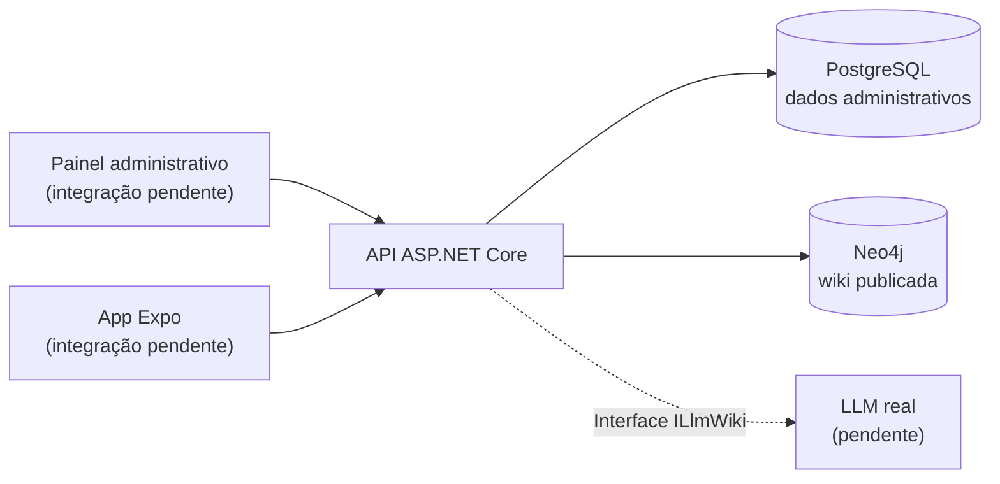
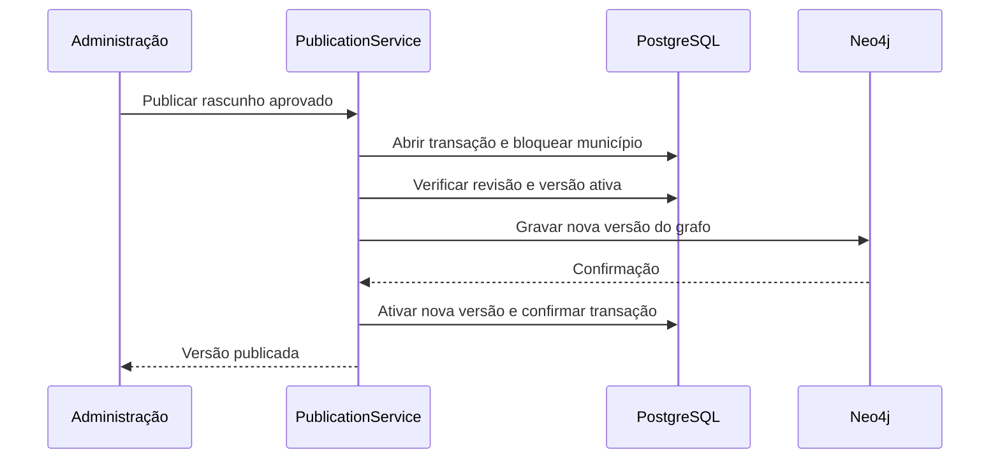

# Entrega técnica — SOA e C#

Projeto: **Fácil Município — Wiki Cidade**  
Disciplinas: **Arquitetura Orientada a Serviços e Web Services** e **C# Software Development**  
Referência: briefing CitizenTech 2026.2, páginas 27 e 30.

## 1. Problema e proposta

O morador de uma cidade nem sempre sabe em qual canal consultar um serviço público. O Fácil Município organiza orientações de fontes oficiais e oferece uma consulta em linguagem natural, com referência à publicação de origem.

A cidade usada no piloto é Poá (SP), com foco em serviços urbanos. A API faz a parte de cadastro, revisão, publicação e consulta. Ela faz parte do mesmo projeto desenvolvido pelo grupo para as demais disciplinas.

O backend foi organizado como um monólito modular em ASP.NET Core. Não criamos uma API para cada disciplina, porque SOA e C# avaliam aspectos diferentes da mesma aplicação.

## 2. Arquitetura



**PostgreSQL:** guarda os municípios, usuários, fontes cadastradas, rascunhos e versões da wiki. O Entity Framework Core cuida das consultas e da persistência. A migração inicial está em `apps/api/Data/Migrations`.

**Neo4j:** guarda o conteúdo aprovado para consulta. Os serviços são associados às fontes, às etapas, aos requisitos, aos órgãos e aos canais. Cada nó do serviço contém município e versão para evitar misturar informações.

**API:** autentica o administrador, verifica a autorização por município, recebe revisões, publica no grafo e responde às chamadas do app. O código está dividido em `Domain`, `Data`, `Contracts`, `Controllers`, `Services` e `Security`.

## 3. Modelo de domínio

| Entidade | Responsabilidade |
|---|---|
| `Municipio` | Identificação da cidade, URL institucional e versão ativa |
| `Usuario` | Conta administrativa, perfil e município autorizado |
| `Fonte` | Texto consultado, título, URL, cidade e data |
| `Rascunho` | Serviço preparado para revisão, identificador da revisão e aprovação |
| `Versao` | Identificação e status da publicação no grafo |
| `ServicoRevisado` | Descrição, órgão, etapas, requisitos, termos e canal do serviço |

O domínio não é apenas uma coleção de DTOs. `Rascunho.Revisar` altera o conteúdo, registra quem revisou e gera uma nova revisão. `Versao.Publicar` altera o estado da publicação. A regra que impede publicar um rascunho não aprovado fica no `PublicationService`.

Os serviços recebem suas dependências por construtor. `IKnowledgeGraph` isola o acesso ao Neo4j; `ILlmWiki` separa o mecanismo de resposta do restante do sistema. Essa divisão permite testar a API sem usar uma LLM real.

## 4. Banco de dados e migrações

O `AppDbContext` mapeia as cinco entidades e configura chaves, índices e relacionamentos. Há restrição de unicidade para o e-mail do usuário e chaves estrangeiras para município, fonte e rascunho. As operações usam EF Core e LINQ; chamadas ao banco e ao grafo são assíncronas.

O esquema foi versionado por migração do Entity Framework Core, e o CI confere se houve mudança no modelo sem gerar migração. Não usamos `EnsureCreated` para substituir esse processo.

### Publicação e recuperação de falhas

A publicação passa por estas etapas:



A versão anterior permanece ativa até a transação do PostgreSQL terminar. Se a gravação do Neo4j falhar, a versão nova não é ativada. Repetir a publicação de uma mesma revisão devolve a versão já criada.

Como PostgreSQL e Neo4j não compartilham uma transação distribuída, uma falha posterior à gravação do grafo pode deixar uma versão órfã. Ela não será consultada porque o PostgreSQL não a aponta como ativa. A limpeza dessas versões é uma melhoria futura.

## 5. APIs REST

As rotas são documentadas pelo Swagger e seguem o prefixo `/api/v1`. A API retorna JSON em camelCase. O OpenAPI contém o esquema **Bearer JWT** apenas nas operações administrativas; o teste HTTP confere que a listagem de municípios e o login permanecem públicos. No Swagger, o token obtido no login pode ser informado pelo botão **Authorize**.

| Método | Endpoint | Acesso |
|---|---|---|
| POST | `/auth/login` | Público (login administrativo) |
| POST | `/municipios` | Operador |
| POST | `/usuarios` | Operador |
| GET/POST | `/municipios/{id}/fontes` | Administração autorizada |
| POST | `/fontes/{id}/rascunhos` | Administração autorizada |
| POST | `/fontes/{id}/extracoes` | Administração; LLM pendente |
| GET/PUT | `/rascunhos/{id}` | Administração autorizada |
| POST | `/rascunhos/{id}/publicacao` | Administração autorizada |
| GET | `/municipios/{id}/versoes` | Administração autorizada |
| GET | `/municipios` | Público |
| GET | `/municipios/{id}/servicos` | Público |
| POST | `/municipios/{id}/conversas` | Público |

Exemplo de chamada à conversa:

```json
{
  "pergunta": "Como solicito a retirada de um sofá?",
  "historico": []
}
```

A resposta inclui `resposta`, `servicosRelacionados`, `fontes`, `informacaoSuficiente` e, quando disponível, `canalOficialUrl`.

Perguntas e histórico não são persistidos no backend. O histórico das conversas deve ficar no SQLite do aplicativo.

## 6. Validações e segurança

- JWT para rotas administrativas, com perfis `ADMIN` e `OPERADOR`.
- Verificação de autorização no servidor, inclusive em fontes, rascunhos e publicações.
- Validação de campos e URLs HTTPS nas entradas.
- Limites de tamanho de requisição, pergunta e histórico.
- Tratamento uniforme de erros HTTP e limite de requisições no login e nas perguntas.
- Remoção básica de padrões de CPF, e-mail e senha antes de repassar texto ao respondedor.
- Credenciais obtidas do ambiente; nenhum token ou senha real deve entrar no GitHub.

A higienização acima é uma proteção inicial da API. Ela não substitui o trabalho de taint analysis e o módulo específico de Cybersecurity.

## 7. Testes e cenário do piloto

O projeto de testes fica em `tests/Api.Tests/`, usando xUnit. Há casos de domínio, validação, privacidade, respostas demonstrativas e integração HTTP com os bancos reais.

Os testes de integração verificam publicação apenas depois da revisão, repetição segura, manutenção da versão anterior em falha, acesso de administradores, isolamento entre cidades, retorno de fonte e respostas insuficientes.

Além disso, `scripts/demo_fluxo_http.py` executa um roteiro usando uma [notícia pública da Prefeitura de Poá sobre Cata Treco](https://poa.sp.gov.br/programa-cata-treco-reforca-limpeza-urbana-e-evita-descarte-irregular-em-poa/). O roteiro cadastra uma fonte, cria e aprova um rascunho manual, publica no grafo e consulta a retirada de sofá. O resultado inclui a fonte oficial. Há um teste negativo para informação não documentada e outro de isolamento municipal.

**Esse roteiro é uma demonstração do backend, não do aplicativo.** O modo `Llm__Mode=demo` compõe respostas com o conteúdo previamente revisado; não realiza extração por LLM. O resultado do workflow deve ser usado como referência para o número atual de testes aprovados.

## 8. Relação com a avaliação

### SOA — página 27 (10 pontos)

| Critério | Peso | Evidência |
|---|---:|---|
| Estruturação do domínio | 3,0 | `Domain/Entities.cs`, `Services/PublicationService.cs` |
| Conexão com banco | 3,0 | `Data/AppDbContext.cs`, Npgsql/EF Core, consultas e relacionamentos |
| Migrações | 1,5 | `Data/Migrations/` e verificação no CI |
| Documentação automática | 1,5 | Swagger gerado em `/swagger` |
| Testes automatizados | 1,0 | xUnit, resultados TRX, testes de integração e roteiro HTTP |

### C# — página 30 (10 pontos)

| Critério | Peso | Evidência |
|---|---:|---|
| Programação Orientada a Objetos | 3,0 | Entidades, métodos de domínio, serviços, interfaces e DI |
| Web API | 2,5 | Controllers, rotas REST, validação e respostas HTTP |
| EF Core + LINQ | 1,5 | `AppDbContext`, repositório de entidades e consultas |
| `async/await` | 1,0 | Controllers e serviços de banco/grafo |
| Qualidade do código | 2,0 | Separação de responsabilidades, tratamento de erros, testes e documentação |

Os pesos são os do briefing; **não representam nota atribuída**.

## 9. Execução e evidências

As instruções completas estão no [README da API](../apps/api/README.md). Na raiz do projeto, os comandos principais são:

```bash
docker compose up -d
dotnet run --project apps/api -- --migrate
dotnet run --project apps/api -- --bootstrap
dotnet run --project apps/api
dotnet test tests/Api.Tests/Api.Tests.csproj -c Release
```

As variáveis e credenciais locais devem ser configuradas antes dos comandos.

A execução automatizada também gera Swagger/OpenAPI, capturas do navegador, resultados TRX e o JSON do cenário de Poá. Consulte [evidências da API](evidencias-soa-csharp.md) e os artefatos do GitHub Actions.

## 10. Pendências de integração e envio

O backend está na branch `feat/soa-csharp-api` e no [PR #2](https://github.com/Luansramos/F-cil-Munic-pio-wiki-cidade/pull/2). A equipe precisa conferir os nomes dos integrantes, realizar a revisão por outro integrante, integrar o PR à `main` e enviar o link final na tarefa de cada disciplina.

A integração visual com Expo, o painel React e a LLM real pertencem ao projeto como um todo, mas ainda não foram homologados por este backend. Não há evidência de um aplicativo completo executado com a API.
