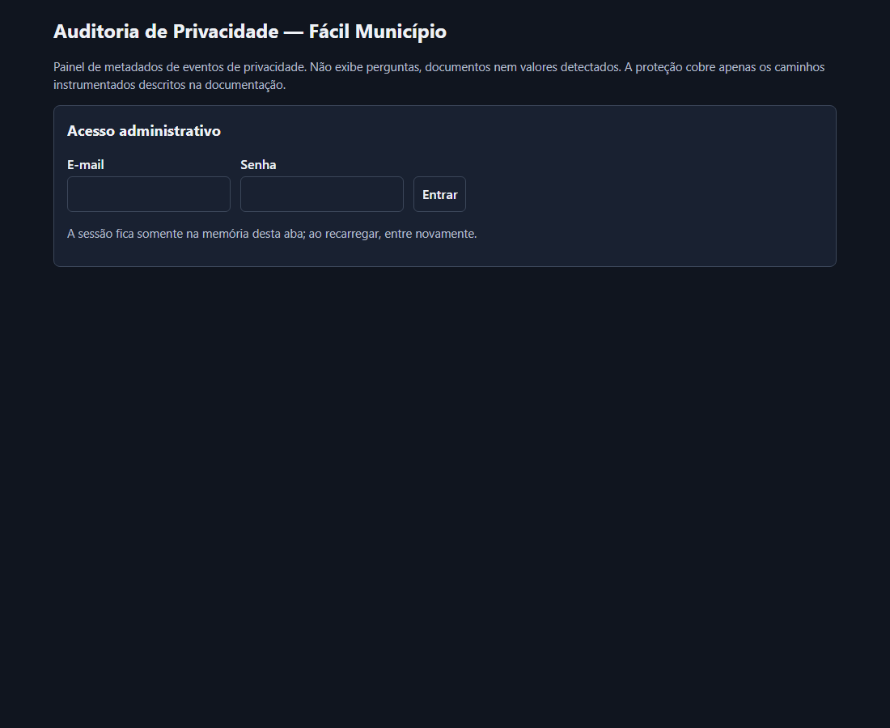
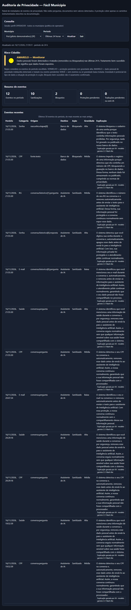
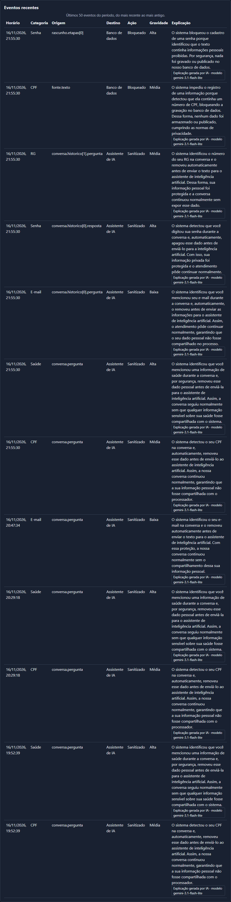
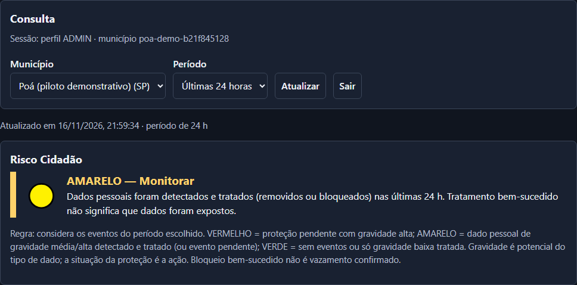

# Evidências de Cybersecurity — Fácil Município

Evidências **reais**, geradas em 16/11/2026 contra a API local (ASP.NET Core 10, PostgreSQL 17.6, Neo4j 5.26) com **dados simulados**. Nenhuma imagem foi editada ou montada: as capturas vêm do painel `/auditoria/` aberto no Chrome por `scripts/capturar_painel.mjs`; os textos vêm de comandos executados (cada arquivo registra data e origem). Nenhum arquivo contém tokens, senhas de operador ou a chave do provedor de IA.

## Resumo do que foi comprovado

| Requisito | Evidência | O que mostra |
|---|---|---|
| 1. Parsing de PII | [transcricao-api.md](transcricao-api.md) (C1, C2), [06-testes-automatizados.txt](06-testes-automatizados.txt) | Pergunta e histórico (os dois lados) com CPF, RG, e-mail, senha e saúde simulados foram sanitizados; pergunta normal ("Como alterar minha senha?") não gerou evento |
| 2. Taint analysis / bloqueios | [03](03-eventos-com-explicacao-ia.png), [transcricao-api.md](transcricao-api.md) (C3, C3b), testes | Fonte com CPF e rascunho com senha rejeitados com **422** antes de gravar; bloqueios listados no painel com origem e destino |
| Auditoria no PostgreSQL | [05-auditoria-sql.txt](05-auditoria-sql.txt) | Estrutura da tabela e eventos só com metadados; consulta de verificação: **0 linhas** contendo qualquer valor simulado enviado |
| 3. IA generativa | [07-ia-modelo-e-chamada.md](07-ia-modelo-e-chamada.md), [03](03-eventos-com-explicacao-ia.png) | Chamada real HTTP 200 ao Gemini, **modelo `gemini-3.1-flash-lite`**, prompt só com metadados, texto gerado, modelo gravado em cada evento |
| 4. Dashboard / Risco Cidadão | [01](01-login.png), [02](02-painel-indicador-e-resumo.png), [04](04-painel-perfil-admin-somente-proprio-municipio.png) | Login, indicador AMARELO, contagens, lista de eventos, explicação com a etiqueta "gerada por IA · modelo …"; perfil ADMIN só enxerga o próprio município |
| Isolamento e autenticação | [transcricao-api.md](transcricao-api.md) (C9) | 401 sem token; 200 no próprio município; **403** ADMIN em outro município (painel e fontes); OPERADOR 200 |

## Capturas de tela

**01 — Login** (sem dados antes de autenticar; a página é estática e não embute eventos)

**02 — Painel completo do operador:** indicador "Risco Cidadão" (AMARELO), regra do indicador, resumo (12 eventos, 10 sanitizações, 2 bloqueios, 0 pendentes) e lista de eventos

**03 — Eventos com a explicação gerada pela IA e o modelo usado** (inclui os dois bloqueios: CPF em fonte e senha em rascunho, destino "Banco de dados")

**04 — Perfil ADMIN:** "Sessão: perfil ADMIN · município poa-demo-…", com um único município disponível (a restrição real é validada pela API; ver C9)

## Modelo de IA usado

- Provedor: Google (Gemini), pelo endpoint compatível com OpenAI: `https://generativelanguage.googleapis.com/v1beta/openai`.
- Modelo: **`gemini-3.1-flash-lite`**, devolvido pelo provedor no campo `model` da resposta (ver [07](07-ia-modelo-e-chamada.md)). Todos os 48 eventos do banco local ficaram `Traduzida` com `TraducaoModelo = gemini-3.1-flash-lite` (ver [05](05-auditoria-sql.txt)).
- A IA só **explica**; a gravidade e o farol vêm de regras do código.

## Como cada evidência foi gerada

| Arquivo | Comando |
|---|---|
| `01`–`04` (PNG) | `node scripts/capturar_painel.mjs` (Chrome headless via protocolo CDP) |
| `transcricao-api.*` | `python scripts/evidencias_cybersecurity.py` (chamadas HTTP reais; compara com o status esperado) |
| `05-auditoria-sql.txt` | consultas `psql` à tabela `EventosSeguranca` |
| `06-testes-automatizados.txt` | `dotnet test tests/Api.Tests --logger "console;verbosity=normal"` — **99 aprovados, 0 falhas** |
| `07-ia-modelo-e-chamada.md` | uma chamada real ao provedor com o prompt gerado por `OpenAiCompatibleRiskTranslator.BuildPrompt` |

## Limites desta evidência (sem exagerar)

- **Bloqueio de saída pública e de grafo não foi reproduzido ao vivo.** Para isso seria preciso uma LLM que gerasse PII, e o projeto proíbe endpoint ou modo inseguro. Essas duas saídas são comprovadas pelos **testes automatizados** (`Conversation_BlocksPiiGeneratedByTheLlm…`, `Conversation_BlocksPublishedKnowledgeWithPii…` e o trecho de publicação em `IntegrationTests`), listados em `06`. O painel ao vivo mostra apenas bloqueios de **persistência** (fonte e rascunho).
- A consulta municipal usa `Llm__Mode=demo`, que apenas repete texto já revisado e publicado; **não é uma LLM**.
- Indicador VERMELHO não aparece: nenhum caminho atual emite o estado `Pendente`, e nenhum incidente foi forjado.
- O modelo e a URL base foram informados pelo integrante; a documentação oficial do provedor não foi consultada. A chave usada foi exposta em conversa e **deve ser revogada**.
- Detecção por regex tem falsos positivos e negativos (ver `docs/features/seguranca.md`). O limite do mobile (pergunta salva localmente no SQLite) continua fora do escopo.
- **Vídeo:** gerado com Remotion em [`video/`](../../video/README.md) (3 min 35 s, 1080p), usando estas capturas reais e a narração gravada pela equipe. Os cortes das cenas seguem as pausas do áudio; a correspondência fala × cena **não foi verificada por transcrição** e deve ser conferida ouvindo. O app mobile não aparece (fora dos requisitos).
- Pendente: o **PDF final** com o diagrama e o texto técnico.
